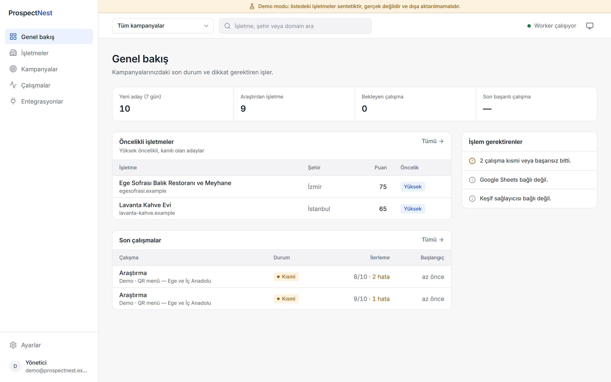
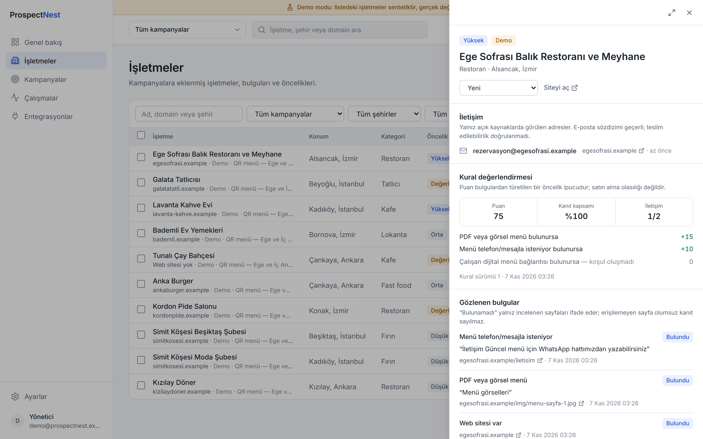
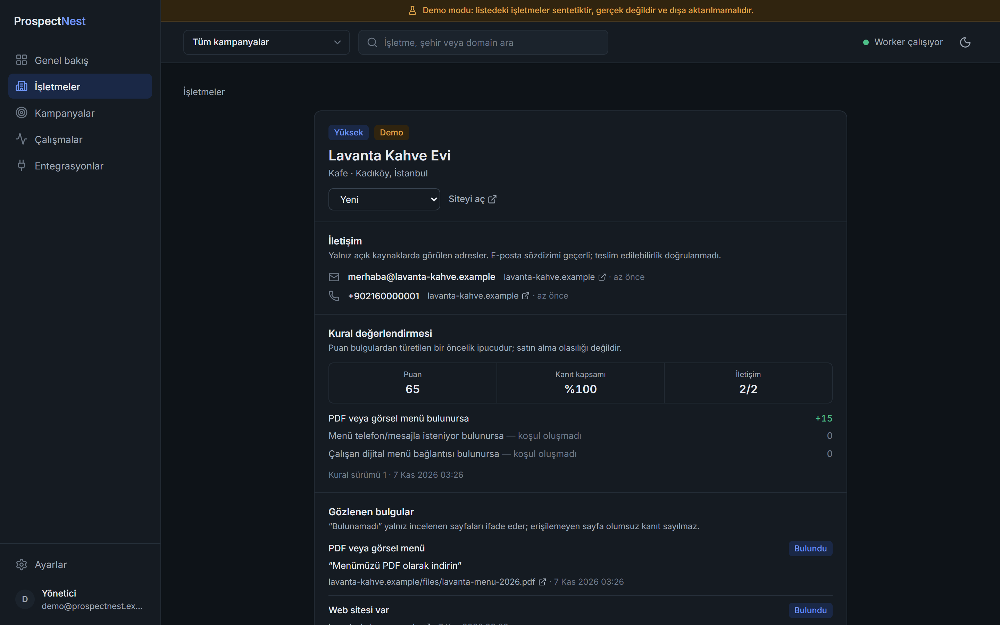
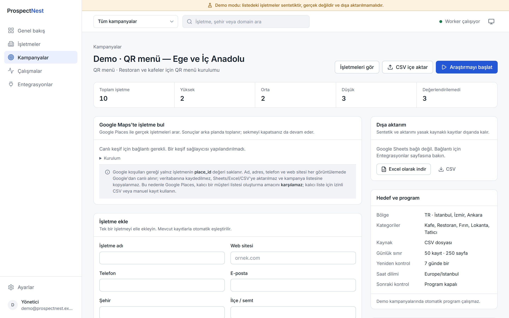
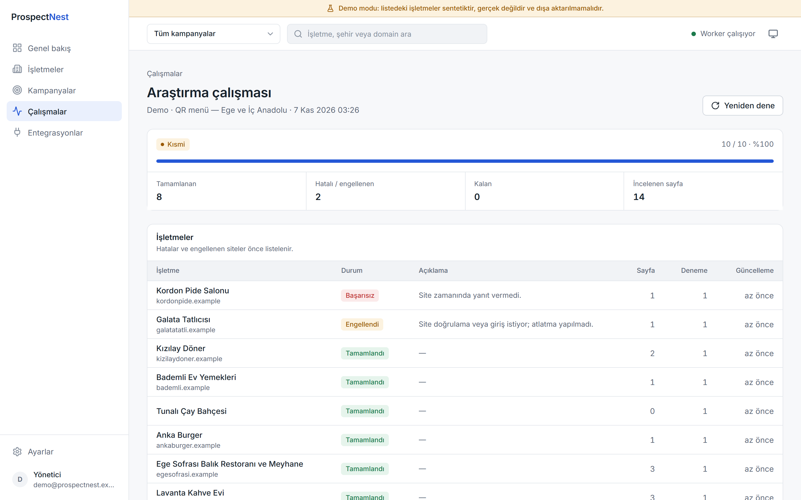
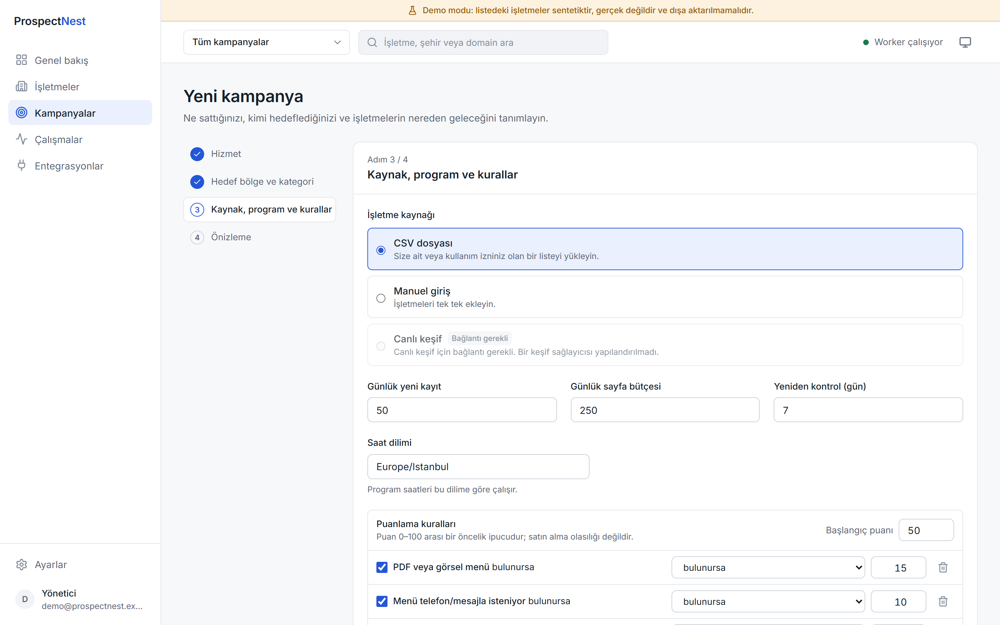
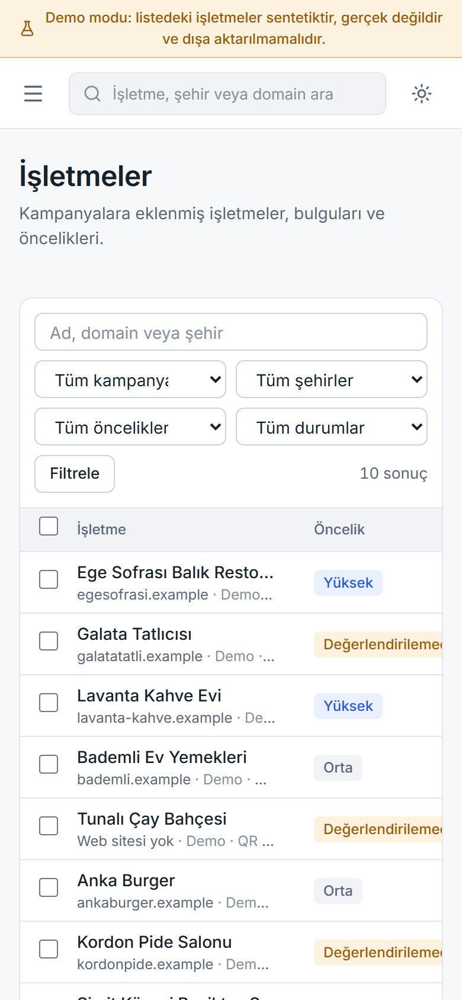
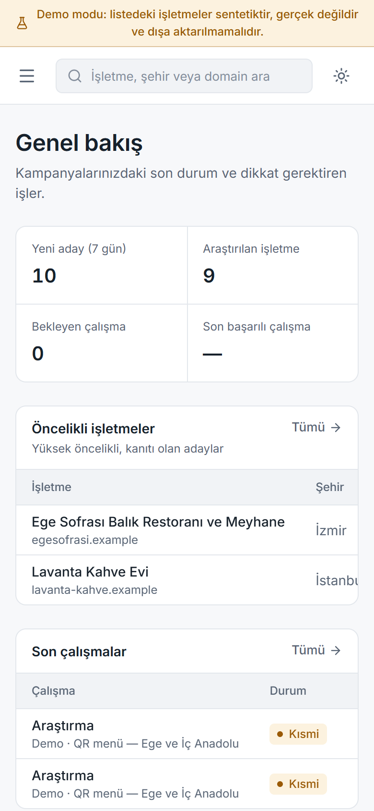
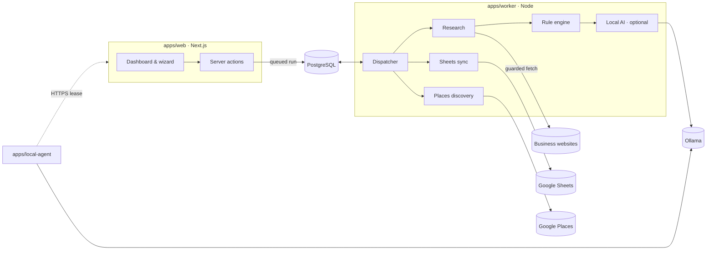

<div align="center">

# ProspectNest

**Evidence-based business prospecting with rule-based qualification, optional local AI and Google Sheets sync.**

Find the businesses that actually need what you sell — and see *why*, with a source link for every claim.

[](https://github.com/LordAurora/ProspectNest/actions/workflows/ci.yml)




</div>

---

## Why

Cold outreach lists are usually a spreadsheet of names with no context. ProspectNest turns a list of businesses into **qualified, explainable leads**:

- It **inspects each business's own website** (safely) and records what it actually observed — a PDF menu, an online booking link, a WhatsApp contact — with the source URL, the time and a short quote.
- A **versioned rule engine** turns those observations into a 0–100 priority score. Every point is traceable to evidence; nothing is guessed.
- It is honest about uncertainty: *"not observed on the inspected pages"* is never treated as *"the business doesn't have it"*, and an unreachable site is never negative evidence.

The first use case is selling QR menus to restaurants, but campaigns are template-driven: websites, appointment systems, reservations and e-commerce ship as templates too.

> The interface is in Turkish; code, comments and this README are in English.

## Features

| | |
| --- | --- |
| **Campaigns** | Four-step wizard: service template → target cities & categories → source, schedule and scoring rules → preview. |
| **Import** | CSV/manual entry with column mapping, per-row validation, encoding detection and dedupe (source id → domain + branch → "possible duplicate" review). Re-importing never grows the table; chain branches stay separate. |
| **Safe web research** | Background worker with SSRF protection (connect-time DNS checks, private/metadata ranges blocked, redirects re-validated), robots.txt, size/time limits, captcha and login walls reported — never bypassed. |
| **Explainable scoring** | Rule DSL over a fixed signal catalog, `present / not_observed / unknown` states, evidence coverage and contactability kept separate from the need score. |
| **Durable runs** | pg-boss jobs with checkpoints, cancellation at safe points, bounded retry with jitter, daily page budgets, crash-safe resume and one active run per campaign. |
| **Scheduling** | Timezone-aware daily rechecks; one slot per local day, a single catch-up run after downtime. |
| **Exports** | Google Sheets sync by `lead_id` that never touches your own columns, plus formatted **Excel** and CSV downloads. Source policies are enforced on every export. |
| **Google Maps discovery** | Optional Google Places (New) search that stores only place IDs and shows details live with attribution — see [compliance](#data-sources-and-compliance). |
| **Local AI (optional)** | Ollama analysis next to — never instead of — the rule result. Evidence-bound JSON output, prompt-injection hardening, cached by evidence hash. |
| **Hybrid agent** | Run the server in the cloud and the model on your own computer: a CLI agent leases AI jobs over HTTPS with scoped, revocable tokens. |
| **SaaS-grade UI** | Light/dark themes, keyboard-accessible drawer, responsive tables, loading/empty/error states everywhere. |

## Screenshots

<table>
  <tr>
    <td width="50%"><br /><sub><b>Businesses</b> — filters, bulk actions and a quick-view panel with evidence.</sub></td>
    <td width="50%"><br /><sub><b>Lead detail</b> — contacts, rule breakdown, observed evidence and timeline (dark theme).</sub></td>
  </tr>
  <tr>
    <td><br /><sub><b>Campaign</b> — priority breakdown, Google Maps discovery, Excel/Sheets export, schedule.</sub></td>
    <td><br /><sub><b>Research run</b> — live progress, blocked and failed sites with actionable reasons.</sub></td>
  </tr>
  <tr>
    <td><br /><sub><b>Campaign wizard</b> — template rules with bounded weights.</sub></td>
    <td align="center">&nbsp;<br /><sub><b>Mobile</b> — the shell becomes a drawer; tables reduce to essentials.</sub></td>
  </tr>
</table>

## How it works



Long work never runs inside a web request: the UI records a queued run and returns immediately; the worker claims it with `SKIP LOCKED`, and pg-boss owns retries and crash recovery. Every side effect is idempotent because the queue is at-least-once.

### Scoring example (QR menu template)

| Signal on the website | Rule | Effect |
| --- | --- | ---: |
| PDF or image menu found | present | **+15** |
| "Ask us for the menu on WhatsApp" — quoted | present | **+10** |
| Working digital menu link (verified to load) | present | **−35** |
| Page unreachable | — | 0 · lowers coverage, not the score |
| E-mail found | — | 0 · affects contactability only |

Base score 50, clamped to 0–100. Below 50 % evidence coverage the score is kept but the lead is marked *not evaluated*. The score is a priority hint, **not** a purchase probability.

## Quick start

**Requirements:** Node.js 22+, pnpm 10, PostgreSQL 17 (or Docker).

```bash
pnpm install
cp .env.example .env              # set DATABASE_URL and SESSION_SECRET
pnpm db:migrate
pnpm admin:create --email you@example.com
pnpm dev                          # web on http://localhost:3000 + worker
```

**Try it with demo data** — synthetic, clearly labelled, never exportable:

```bash
# in .env: DEMO_MODE=true  (answers reserved .example domains from local fixtures)
pnpm db:seed
```

Then open the demo campaign and press **Araştırmayı başlat** to watch the full pipeline run offline.

### Docker Compose

```bash
cp .env.example .env              # set POSTGRES_PASSWORD and SESSION_SECRET
docker compose up -d --build
docker compose run --rm migrate pnpm admin:create --email you@example.com
```

Postgres data lives in a named volume; a one-shot `migrate` service runs before web and worker start.

## Configuration

| Variable | Purpose |
| --- | --- |
| `DATABASE_URL` | PostgreSQL connection string |
| `SESSION_SECRET` | ≥ 32 random characters; signs session and agent tokens |
| `DEMO_MODE` | `true` serves `.example` sites from fixtures and shows the demo banner |
| `GOOGLE_APPLICATION_CREDENTIALS`, `GOOGLE_SPREADSHEET_ID` | Service-account key file and the spreadsheet you shared with it |
| `DISCOVERY_PROVIDER`, `GOOGLE_PLACES_API_KEY`, `GOOGLE_PLACES_DAILY_REQUEST_LIMIT` | `google_places` enables discovery; the key stays server-side |
| `AI_MODE` | `disabled` (default), `local` (worker calls Ollama) or `agent` (hybrid) |
| `OLLAMA_BASE_URL`, `OLLAMA_MODEL` | Local model endpoint and name; models are never downloaded automatically |
| `WORKER_CONCURRENCY` | Businesses researched in parallel per run |

## Integrations

<details>
<summary><b>Google Sheets</b></summary>

1. Create a service account, download its JSON key and point `GOOGLE_APPLICATION_CREDENTIALS` at it.
2. Share your spreadsheet with the service-account e-mail (shown on the Integrations page) and set `GOOGLE_SPREADSHEET_ID`.
3. Press **Bağlantıyı test et**, then **Sheets'e aktar** on a campaign.

Each campaign writes to its own tab. The app owns columns A–O and matches rows by `lead_id`, so you can sort freely and your follow-up columns (`takip_durumu`, `notlar`, …) are never overwritten. Values are written RAW. Header changes or duplicated ids stop the sync instead of risking a wrong row.
</details>

<details>
<summary><b>Google Maps discovery (Places API)</b></summary>

Enable billing and **Places API (New)** in Google Cloud, create a key restricted to that API, then set `DISCOVERY_PROVIDER=google_places` and `GOOGLE_PLACES_API_KEY`. The app never enables paid services for you.

Search uses an ID-only field mask (up to 60 results, paginated). Details are fetched live when you view results. See the compliance notes below before relying on it.
</details>

<details>
<summary><b>Local AI with Ollama</b></summary>

Install Ollama, pull a small multilingual model yourself, set `AI_MODE=local` and `OLLAMA_MODEL`. The model receives scraped text only as delimited, untrusted data, gets no tools, and must cite evidence ids that exist; invalid output gets one correction attempt and then fails without affecting the rule result.

**Hybrid mode:** set `AI_MODE=agent` on the server, create a token under *Ayarlar → Yerel AI agent'ları*, then on your computer:

```bash
cp apps/local-agent/.env.example apps/local-agent/.env   # SERVER_URL, AGENT_TOKEN, OLLAMA_MODEL
pnpm agent
```

The server's `localhost` is not your computer — the agent always connects out over HTTPS, and Ollama's port never needs to be exposed.
</details>

## Data sources and compliance

- **No Google Maps scraping.** Discovery uses the official Places API only.
- **Google Places content is not stored or exported.** Per the Google Maps Platform policies, place IDs may be stored indefinitely, but names, addresses, phones and websites may not be cached, exported or copied into a saved list. ProspectNest therefore stores only place IDs, shows details live with *Google Maps* attribution, and keeps them out of the database, Sheets, Excel and CSV. **Google Places cannot be used to build a persistent lead list** — use a CSV you own or have permission to use, or manual entry.
- **E-mails are never guessed.** Only addresses published on a business's own pages are collected; syntax-valid does not mean deliverable.
- **Synthetic demo data** uses reserved `.example` domains, is labelled everywhere and is blocked from every export.

## Security

Argon2id passwords, HMAC-hashed session and agent tokens, rate-limited login, origin-checked mutations, SSRF-hardened fetching and formula-safe exports. Details and how to report a vulnerability: [SECURITY.md](SECURITY.md).

## Testing

```bash
pnpm typecheck
pnpm test                                          # unit + fixture tests
TEST_DATABASE_URL=postgresql://... pnpm test       # adds PostgreSQL integration tests
```

The suite covers CSV parsing and dedupe keys, the rule engine, SSRF guards and robots.txt, research against synthetic sites (PDF menu, verified digital menu, captcha, timeout), crash-resume and at-least-once delivery, concurrent schedulers, Sheets sync after user sorting and lost responses, Places pagination/quota/cancel, AI output validation and prompt injection, hybrid-agent lease expiry and stale results. CI runs everything against a real PostgreSQL service.

## Project structure

```text
apps/
  web/           Next.js app: UI, auth, server actions, agent API
  worker/        Research, scoring, scheduling, Sheets, Places, AI jobs
  local-agent/   Optional CLI that runs AI jobs on your own computer
packages/
  core/          Domain types, rule DSL, scoring, CSV, time zones
  db/            Prisma schema, migrations, import/dedupe/export services
  research/      SSRF-safe fetcher, robots.txt, evidence extraction
  integrations/  Google Sheets, Google Places, Ollama, Excel
  providers/     Data-source capability policies
  test-fixtures/ Synthetic websites for offline tests and the demo
```

## Known limitations

- JavaScript-rendered sites and the contents of PDF menus are not read; only their links are detected.
- Single administrator; no multi-tenant workspaces, SSO or billing.
- Live Google Sheets, Google Places and Ollama calls require your own credentials; the test suite uses faithful fakes.

## License

[MIT](LICENSE)
